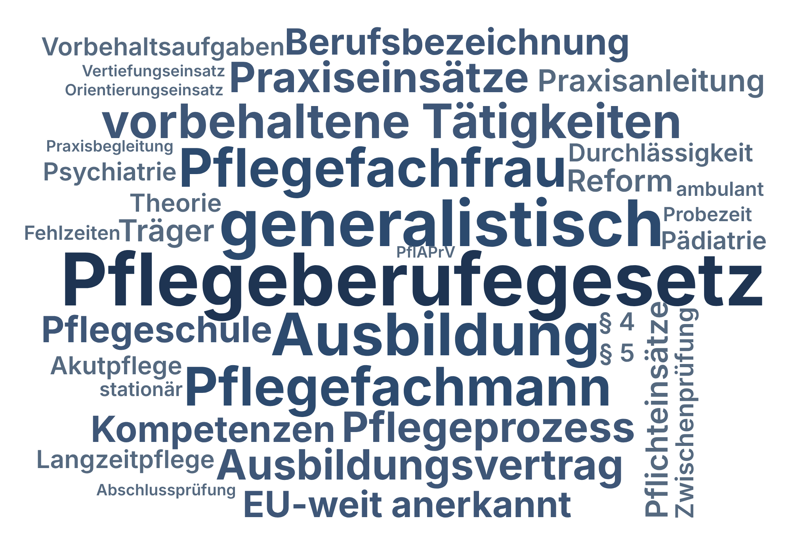

# Reveal-TermCluster

[](https://revealjs.com) [](LICENSE)

Interactive word clouds for [reveal.js](https://revealjs.com). Author a topic's key terms as a simple list — a leading number sets each word's size — and TermCluster renders a lively, readable cloud that looks the same every time. On **hover** (desktop) or **tap** (touch / smartboard) a word grows and comes into focus while the rest steps back. Standalone (ships its own CSS), colours and shapes are easy to theme, and it works fully offline.

**[Live demo](https://florianloyns.github.io/reveal.js-termcluster/demo.html)**

[](https://florianloyns.github.io/reveal.js-termcluster/demo.html)

## Why — the advance organizer

A word cloud is a great **advance organizer** (Ausubel): before you dive into a topic, you show its landscape of key terms at a glance. That activates prior knowledge ("which of these do you already know?"), gives an overview of what's coming, and — tapped again at the end of the lesson — doubles as a recap to check completeness. The size of a word is a deliberate teaching signal: the biggest words are your anchors. Because you set the sizes yourself (or let them be assigned automatically), the cloud reflects *your* emphasis, not a word-frequency count.

## Installation

**Requires** reveal.js 4.2 or newer. Tested with reveal.js 5.x.

Copy the `termcluster` folder (including its `vendor/` subfolder) into your reveal.js `plugin/` folder — or install from npm.

```console
npm install reveal.js-termcluster
```

## Setup

TermCluster uses the bundled [wordcloud2.js](https://github.com/timdream/wordcloud2.js) for the packing, so **load `vendor/wordcloud2.js` before the plugin**.

**Regular**

```html
<script src="dist/reveal.js"></script>
<script src="plugin/termcluster/vendor/wordcloud2.js"></script>
<script src="plugin/termcluster/termcluster.js"></script>
<script>
  Reveal.initialize({ plugins: [ RevealTermCluster ] });
</script>
```

**As a module**

```html
<script src="plugin/termcluster/vendor/wordcloud2.js"></script>
<script type="module">
  import Reveal from './dist/reveal.esm.js';
  import RevealTermCluster from './plugin/termcluster/termcluster.esm.js';
  Reveal.initialize({ plugins: [ RevealTermCluster ] });
</script>
```

## Usage

Write your words as a list inside a `<div class="termcluster">` — one per line, a **number in front sets the size**. Words without a number get a pleasant automatic size, so you never *have* to weight them. In a mixed list, words without a number get a size from the lower end of your weights instead of disappearing.

```html
<div class="termcluster">
  14 Photosynthesis
  9 Chlorophyll
  7 Sunlight
  6 Oxygen
  Glucose
</div>
```

Big number = big word, while even the smallest term stays readable (at least 20 px). Tap a word to bring it into focus; tap again to release. Feedback is by size and colour only, so nothing shifts on the slide.

Prefer elements? `<span data-weight="9">Chlorophyll</span>` works too.

## Layouts

**`vivid` (default)** — a strong size hierarchy with readable small words and good use of the available space:

- No word is drawn smaller than `minFontSize` (default 20 px). If the cloud is too crowded, the *whole* cloud is scaled down evenly. The only exception: a very long main term (think "Pflegeberufegesetz") is reduced just enough to fit the cloud's width instead of being left out.
- The same words and settings always give the same arrangement, so a slide looks identical every time you open it. Use `data-seed` to try a different arrangement.
- Several arrangements are tried and the most balanced one is kept. A few words are turned upright for variety; the biggest and long terms stay horizontal.
- With more than 38 terms, a more compact typography is used automatically so that as many words as possible fit.
- If some words still cannot be placed, the cloud shows the best arrangement it found. Nothing appears on the slide, but the browser console lists the missing terms and the cloud gets `data-tc-missing="N"`. Fix it by shortening the list or making the cloud larger.
- When the cloud is the only element inside a card body (`.s-body`), it grows into the free height of that card (up to 580 px).

**`classic`** — the original renderer from 1.1: words are shrunk individually to fit, and the arrangement changes on every load. Use `data-layout="classic"` on one cloud or `layout: 'classic'` globally.

Clouds that still say `data-layout="expressive"` or `"balanced"` (development versions) are shown with `vivid`.

## Per-slide options

Override the look on any single cloud with `data-*` attributes:

```html
<div class="termcluster" data-shape="cardioid" data-colors="green" data-angles="0"> … </div>
```

| Attribute | Values | Description |
|---|---|---|
| `data-layout` | `vivid` `classic` | Layout, see above (default `vivid`) |
| `data-seed` | text or number | Choose a different, still reproducible arrangement (`vivid`) |
| `data-min-font` | number, px | Smallest allowed text size in `vivid` (default **20**) |
| `data-shape` | `circle` `cardioid` `star` `diamond` `triangle` `pentagon` `square` | Outline the cloud fills |
| `data-ellipticity` | `0`–`1` | Flatness of the shape (lower = wider) |
| `data-grid` | number | Spacing between words (larger = airier) |
| `data-size` | number | Overall size factor (default 7) |
| `data-angles` | `0` `90` `any` | Rotation: none, upright/vertical, or free |
| `data-rotate` | `0`–`1` | Share of rotated words (default 0.28 in `vivid`, 0.24 in `classic`) |
| `data-colors` | `marine` `green` `warm` `dark` | Colour scheme (`dark` = light text for dark slides) |

## Configuration

Global defaults (optional) — any per-slide `data-*` still wins:

```js
Reveal.initialize({
  termcluster: {
    layout: 'vivid',
    shape: 'circle',
    ellipticity: 0.62,
    gridSize: 10,
    weightFactor: 7,
    rotateRatio: 0.28,
    angles: '90',
    colors: 'marine',
    minFontSize: 20
  },
  plugins: [ RevealTermCluster ]
});
```

**Important:** use the bundled `plugin/termcluster/vendor/wordcloud2.js`. It is slightly extended (reproducible random numbers and per-word rotation); an unmodified upstream copy only supports the `classic` layout.

## Changelog

**1.4.0** — New default layout `vivid`: readable minimum text size (20 px, `minFontSize` / `data-min-font`), stronger size hierarchy, better use of the available space, the same arrangement on every load (`data-seed` to vary it), whole-cloud scaling instead of shrinking single words (long main terms are fitted to the cloud width, never dropped), compact typography for lists longer than 38 terms, and missing terms reported in the browser console. Mixed lists give unweighted words a sensible size. Marine colours matched to the presentation theme; a focused word is highlighted in `#2C4A6E`. The previous renderer remains available as `classic`. The bundled wordcloud2.js was extended with a seedable random source and per-word rotation.

**1.1.1** — Print detection unified across the plugin family: every print rule now applies both in the browser print dialog and in reveal’s `?print-pdf` view, so the on-screen preview looks like the PDF; the print view is recognised the same way everywhere (`?print-pdf` or `view: 'print'`).

**1.1.0**

- Robustness: if the packing library never signals completion, the off-screen measuring element is cleaned up after a timeout instead of lingering in the DOM.
- The render-retry counter resets on each build, so a slide that is slow to become measurable still gets a fair chance to render.

**1.0.0** — initial release.

## Credits

Packing by [wordcloud2.js](https://github.com/timdream/wordcloud2.js) © Tim Guan-tin Chien (MIT), bundled with small extensions in `plugin/termcluster/vendor/`. Built for [reveal.js](https://revealjs.com) by Hakim El Hattab.

## Like it?

Star the repo.

## Imprint

Responsible: Florian Loyns — [imprint & privacy notice](https://florianloyns.com/Impressum/) (German)

## License

MIT — see [LICENSE](LICENSE).
